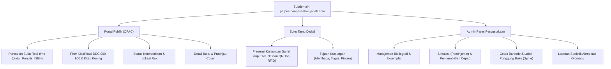
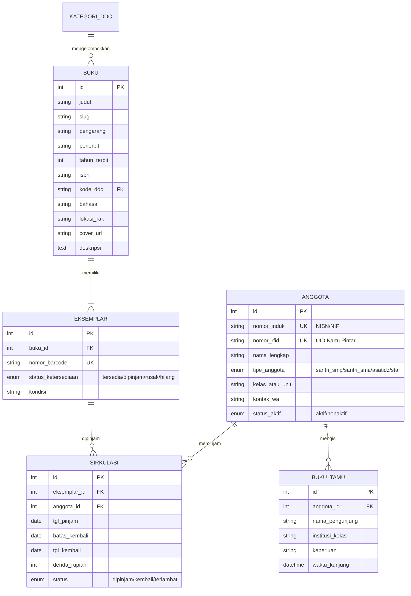

# PRODUCT REQUIREMENT DOCUMENT (PRD)
## SISTEM PERPUSTAKAAN DIGITAL & OTOMASI AKREDITASI
### Pondok Pesantren Babul Jannah (`perpus.ponpesbabauljanah.com`)

---

## 1. Executive Summary & Tujuan Produk

Dokumen ini merupakan panduan spesifikasi dan kebutuhan sistem otomasi perpustakaan pesantren Babul Jannah. Tujuan utama produk ini adalah:
1. **Memenuhi 100% Standar Penilaian Akreditasi Sekolah/Madrasah (BAN-S/M & Kemenag)** untuk komponen sarana prasarana dan perpustakaan digital (Otomasi Perpustakaan / OPAC).
2. **Katalogisasi Koleksi Fisik Modern**: Memudahkan santri, asatidz, dan umum mencari buku pelajaran, kitab kuning, referensi, dan literatur umum dengan cepat dari HP atau laptop.
3. **Pencatatan Presensi & Sirkulasi Otomatis**: Buku tamu kunjungan digital, peminjaman, pengembalian, batas waktu pinjam, dan cetak kartu anggota / label barcode punggung buku.
4. **Efisiensi Hosting 25 GB**: Sistem dirancang dengan *footprint* sangat ringan (< 200 MB), tanpa membebani disk hosting bersama.
5. **Dukungan Kartu Pintar RFID**: Siap membaca tap kartu pintar santri (USB RFID Reader) untuk presensi dan transaksi pinjam instan 2 detik.

---

## 2. Analisis Strategis: Pakai SLiMS Modifikasi vs Bangun Sendiri (From Scratch)

Pertanyaan utama panitia: *Apakah sebaiknya menggunakan SLiMS (Senayan Library Information Management System) yang dimodifikasi, atau membangun sistem sendiri dari nol?*

Berikut perbandingan komprehensifnya:

| Aspek Penilaian | Opsi A: SLiMS 9 (Bulian) Dimodifikasi | Opsi B: Custom Build (Bangun Sendiri dari 0) |
| :--- | :--- | :--- |
| **Pengakuan Asesor Akreditasi** | ⭐️⭐️⭐️⭐️⭐️ **Sangat Tinggi**. Asesor perpustakaan di Indonesia hafal mati struktur SLiMS, standarisasi MARC21, dan format DDC-nya. | ⭐️⭐️⭐️⭐️ **Tinggi**, asalkan struktur metadata (DDC, ISBN, GMD, Barcode, Buku Tamu) mengikuti standar Perpustakaan Nasional. |
| **Kesesuaian Desain & Identitas Brand** | ⚠️ Agak kaku. Mengubah tampilan template SLiMS agar identik dengan desain Tailwind `babul jannah` butuh modifikasi kode PHP legacy & jQuery yang cukup rumit. | ⭐️⭐️⭐️⭐️⭐️ **Sempurna**. Langsung menggunakan Tailwind CSS, palet warna Emerald-Gold khas Babul Jannah, dan font Plus Jakarta Sans. |
| **Integrasi Data Santri** | ⚠️ Terpisah. Harus ekspor santri ke CSV, lalu diimpor manual ke SLiMS tiap tahun ajaran baru. | ⭐️⭐️⭐️⭐️⭐️ **Instan & Otomatis**. Bisa langsung membaca data santri aktif dari database PSB/Portal Babul Jannah (1 ekosistem). |
| **Waktu Pengerjaan** | Cepat (1-2 hari untuk instalasi & konfigurasi dasar, 1 minggu untuk penyesuaian tema). | Bertahap (1-2 minggu pengerjaan terstruktur hingga sirkulasi & barcode siap). |
| **Beban Server (Resource Usage)** | ~150 MB storage, menggunakan query database yang cukup banyak tabel bawaan. | **~30 - 50 MB storage**, database sangat ramping dan optimal untuk CPU 1 Core / 2 GB RAM. |

> ### 💡 Rekomendasi Arsitektur:
> **Pilihan Terbaik:** **Bangun Sistem Mandiri Ringan (Custom Lightweight Library) yang 100% mematuhi Standar Nasional Perpustakaan (SNP)**.
> *Alasan:* Anda mendapatkan kemewahan desain yang menyatu 100% dengan Web Utama & PSB, data santri terhubung otomatis tanpa input ulang, sistem bebas bloatware yang tidak perlu, dan tetap 100% lolos instrumen akreditasi karena fitur wajib asesor terpenuhi lengkap.

---

## 3. Design System & Identitas Visual

Desain antarmuka dirancang mengikuti identitas resmi Pondok Pesantren Babul Jannah: islami, modern, elegan, berwibawa, dan nyaman dibaca (antislop).

### 3.1 Palet Warna (Color Palette)

```
[ Primary: Forest Emerald ]   #0D5C3A   (Warna dasar islami, sejuk, dan akademis)
[ Primary Deep ]              #084028   (Header, aksen tegas, footer)
[ Accent / Gold ]             #D97706   (Badge akreditasi, sorotan buku unggulan)
[ Surface / Background ]      #F8FAFC   (Latar belakang lembut, ramah mata pembaca)
[ Card Surface ]              #FFFFFF   (Kartu katalog buku & kontainer modal)
[ Neutral Dark ]              #0F172A   (Tipografi judul & teks utama)
[ Neutral Muted ]             #64748B   (Keterangan pengarang, penerbit, nomor rak)
[ Success / Tersedia ]        #059669   (Status buku: "Tersedia di Rak")
[ Danger / Dipinjam ]         #DC2626   (Status buku: "Sedang Dipinjam")
```

### 3.2 Tipografi
* **Display Font (Judul Utama & Header):** `Playfair Display`, serif berwibawa untuk nuansa literatur pesantren & keilmuan.
* **UI Font (Body, Tombol, Tabel, Data Teknis):** `Plus Jakarta Sans`, clean, keterbacaan tinggi pada layar ponsel dan tablet.
* **Monospace (Kode ISBN, Klasifikasi DDC, Barcode):** `JetBrains Mono` atau `font-mono`.

---

## 4. Matriks Fitur Lengkap Sesuai Standar Akreditasi

Sistem dibagi menjadi 2 zona: **Portal Publik (Untuk Santri, Guru, & Asesor)** dan **Admin Dashboard (Untuk Petugas Perpustakaan)**.



### 4.1 Modul 1: OPAC (Online Public Access Catalog) - Publik
1. **Hero Pencarian Cepat**: Input pencarian universal (Judul, Pengarang, Penerbit, Subjek, atau ISBN).
2. **Filter Berdasarkan Klasifikasi DDC (Dewey Decimal Classification)**:
   * `000` Karya Umum / Komputer
   * `100` Filsafat & Psikologi
   * `200` **Agama Islam & Kitab Turats (Paling dominan di Pesantren)**
   * `300` Ilmu Sosial & Kewarganegaraan
   * `400` Bahasa (Arab, Inggris, Indonesia)
   * `500` Sains Murni (Matematika, IPA)
   * `600` Ilmu Terapan & Teknologi
   * `700` Kesenian & Olahraga
   * `800` Sastra & Fiksi
   * `900` Sejarah, Biografi, & Geografi Islam
3. **Card Koleksi Buku**: Menampilkan foto cover, judul buku, nama pengarang, tahun, badge klasifikasi, nomor rak, serta badge status:
   * 🟢 **Tersedia (3 Eksemplar di Rak A-02)**
   * 🔴 **Dipinjam (Kembali 05 Nov 2026)**
4. **Detail Koleksi (Modal Pop-up)**: Sinopsis singkat, jumlah halaman, penerbit, nomor panggil (*call number*), dan lokasi fisik lemari.

### 4.2 Modul 2: Buku Tamu Digital (Poin Utama Akreditasi)
*Asesor akreditasi selalu memeriksa data statistik kunjungan perpustakaan per hari/bulan.*
1. **Self-Service Check-in**: Tablet atau PC di meja depan perpustakaan. Santri cukup **menempelkan kartu pintar RFID** atau mengetikkan NISN / scan QR.
2. **Pilihan Tujuan Kunjungan**: Membaca di tempat, Meminjam/Mengembalikan Buku, Mengerjakan Tugas Asrama.
3. **Grafik Kunjungan Real-time**: Total pengunjung hari ini, bulan ini, dan per jenjang (SMP IT vs SMA IT).

### 4.3 Modul 3: Manajemen Sirkulasi (Peminjaman & Pengembalian)
1. **Transaksi Peminjaman Kilat**: Tap kartu RFID santri -> Scan barcode buku -> Selesai tercatat (2 detik).
2. **Aturan Peminjaman Terkonfigurasi**:
   * Maksimal buku dipinjam (misal: 2 buku per santri).
   * Durasi maksimal pinjam (misal: 7 hari).
   * Perhitungan denda keterlambatan otomatis (misal: Rp 500 / hari atau denda membaca/merangkum buku).
3. **Perpanjangan Pinjaman (1x Klik)**.
4. **Riwayat Histori Peminjaman Santri**.

### 4.4 Modul 4: Cetak Label Punggung Buku & Barcode
1. **Generator Barcode Otomatis**: Menghasilkan barcode/QR code unik untuk setiap eksemplar buku fisik.
2. **Cetak Label Punggung (Spine Label)**: Format siap cetak kertas stiker ukuran standar (menampilkan: Logo Babul Jannah, Nomor Panggil DDC, 3 huruf awal pengarang, 1 huruf awal judul).

### 4.5 Modul 5: Laporan Statistik Siap Ekspor Akreditasi
1. Jumlah total judul dan total eksemplar buku.
2. Rasio ketersediaan buku per santri (standar akreditasi: minimal 10-15 buku per 1 santri).
3. Laporan daftar 10 buku paling sering dipinjam (*most popular books*).
4. Rekapitulasi pengunjung bulanan siap unduh PDF / Excel untuk dilampirkan ke berkas akreditasi.

---

## 5. Rincian Spesifikasi Halaman (Sitemap & Page Breakdown)

Sistem dibagi menjadi **4 Halaman Publik (Frontend)** dan **7 Halaman Petugas (Admin Backend)**:

```
perpus.ponpesbabauljanah.com/
│
├── [AREA PUBLIK / SANTRI & ASESOR]
│   ├── /index.php                  (1. Beranda & Katalog OPAC Realtime)
│   ├── /buku.php?id={id}           (2. Halaman Detail Buku & Ketersediaan Rak)
│   ├── /buku-tamu.php              (3. Layar Presensi Kunjungan / Kiosk Touchscreen & RFID)
│   └── /profil.php                 (4. Informasi, Tata Tertib & Denah Perpustakaan)
│
└── /admin/ [AREA PETUGAS PERPUSTAKAAN]
    ├── /admin/index.php            (5. Dashboard Statistik & Alert Jatuh Tempo)
    ├── /admin/buku.php             (6. Kelola Master Bibliografi & Eksemplar)
    ├── /admin/sirkulasi.php        (7. Sirkulasi Kasir: Pinjam, Kembali & Denda)
    ├── /admin/anggota.php          (8. Data Anggota & Cetak KTA Ber-Barcode/RFID)
    ├── /admin/cetak-label.php      (9. Generator Cetak Label Punggung & Barcode Buku)
    ├── /admin/laporan.php          (10. Laporan Rekapitulasi Khusus Borang Akreditasi)
    └── /admin/pengaturan.php       (11. Konfigurasi Batas Pinjam, Durasi & Denda)
```

---

### A. Rincian 4 Halaman Area Publik (Frontend)

#### 1. Halaman Beranda & Katalog OPAC (`/index.php`)
* **Tujuan:** Pintu gerbang pencarian buku mandiri oleh santri, guru, orang tua, maupun tim asesor akreditasi.
* **Komponen & Fitur Utama:**
  * **Hero Header:** Banner islami modern dengan kolom pencarian instan universal (cari berdasarkan Judul, Penulis, Penerbit, atau ISBN).
  * **Quick Filter Kategori DDC 000-900:** Tombol filter cepat untuk kategori buku (Agama Islam/Kitab Kuning, Bahasa, Sains, Sastra, dll).
  * **Grid Koleksi Buku (Card View):** Menampilkan cover buku, judul, pengarang, nomor rak, serta badge status (*Tersedia di Rak A-02* atau *Sedang Dipinjam*).
  * **Filter Status Ketersediaan:** Checkbox *"Hanya tampilkan buku yang sedang tersedia di rak"*.
  * **Pagination Cepat & Responsif:** Tampil rapi di layar smartphone maupun PC.

#### 2. Halaman Detail Buku (`/buku.php?id={id}` atau Modal Pop-up)
* **Tujuan:** Memberikan rincian komprehensif buku sebelum santri mencari fisiknya ke rak perpustakaan.
* **Komponen & Fitur Utama:**
  * Foto cover buku resolusi optimal (format WebP).
  * **Data Bibliografi Lengkap:** Judul lengkap, anak judul, kepengarangan, penerbit, tahun terbit, edisi, cetakan, bahasa, dan nomor ISBN.
  * **Nomor Panggil (Call Number):** Kode klasifikasi DDC + 3 huruf pengarang + 1 huruf judul (contoh: `297.1 MUA t`).
  * **Tabel Eksemplar Fisik:** Rincian jumlah kopi buku yang dimiliki pondok:
    * *No. Barcode*: `BJ-00123` | *Lokasi*: Rak Lemari 2 Baris 3 | *Status*: Tersedia
    * *No. Barcode*: `BJ-00124` | *Lokasi*: Rak Lemari 2 Baris 3 | *Status*: Dipinjam (Jatuh tempo: 08 Nov 2026)
  * Sinopsis / ringkasan isi buku.
  * Rekomendasi buku lain dengan topik serupa.

#### 3. Layar Presensi Kunjungan / Buku Tamu Kiosk (`/buku-tamu.php`)
* **Tujuan:** Ditempatkan di tablet atau monitor layar sentuh (*touchscreen*) di meja depan perpustakaan untuk mencatat daftar hadir otomatis via RFID atau NISN.
* **Komponen & Fitur Utama:**
  * Desain minimalis layar penuh (*full screen kiosk mode*).
  * Input otomatis via pemindaian kartu RFID santri / barcode / ketik NISN.
  * Tombol pilihan cepat keperluan kunjungan: `[Membaca]`, `[Meminjam/Kembali]`, `[Mengerjakan Tugas]`, `[Lainnya]`.
  * **Alert Notifikasi Suara/Visual:** Muncul sambutan ramah instan: *"Ahlan wa Sahlan, Ahmad Harel (Kelas 8 SMP IT Babul Jannah)!"*.
  * Berjalan otomatis tanpa perlu login admin.

#### 4. Informasi, Tata Tertib & Denah Perpustakaan (`/profil.php`)
* **Tujuan:** Menjadi bukti fisik instrumen akreditasi mengenai profil dan SOP perpustakaan.
* **Komponen & Fitur Utama:**
  * Profil perpustakaan Babul Jannah, visi, misi, dan struktur pengelola perpustakaan.
  * Jam operasional buka perpustakaan untuk santri putra & santri putri.
  * Syarat dan tata tertib peminjaman buku asrama.
  * Panduan kode warna rak dan denah ruang baca.

---

### B. Rincian 7 Halaman Area Petugas (Admin Backend)

#### 5. Dashboard Utama Petugas (`/admin/index.php`)
* **Tujuan:** Pusat kendali harian petugas perpustakaan pondok.
* **Komponen & Fitur Utama:**
  * **4 Kartu Metrik Utama:** Total Judul Buku, Total Eksemplar Fisik, Jumlah Pengunjung Hari Ini, dan Buku yang Sedang Dipinjam.
  * **Alert Warning Jatuh Tempo:** Kotak notifikasi daftar santri yang terlambat mengembalikan buku beserta kontak WA wali/santri.
  * **Grafik Visual:** Tren kunjungan mingguan dan kategori buku yang paling diminati santri.

#### 6. Manajemen Master Buku & Eksemplar (`/admin/buku.php`)
* **Tujuan:** Mengelola data inventaris koleksi buku pondok.
* **Komponen & Fitur Utama:**
  * Tabel data seluruh buku dengan pencarian cepat, sortir tahun, dan filter rak.
  * **Modal Tambah/Edit Judul Buku:** Form input judul, pengarang, penerbit, ISBN, DDC, lokasi rak, dan upload cover buku (auto-kompres WebP).
  * **Kelola Sub-Eksemplar:** Fitur menambah jumlah eksemplar fisik buku secara instan (misal 1 judul memiliki 5 buku fisik dengan kode barcode `BJ-001` s/d `BJ-005`).
  * Opsi ubah kondisi eksemplar: *Baik*, *Rusak Ringan*, *Hilang*.

#### 7. Meja Kasir Sirkulasi Cepat (`/admin/sirkulasi.php`)
* **Tujuan:** Memproses pinjam dan kembali buku dalam hitungan detik tanpa mengetik manual.
* **Komponen & Fitur Utama:**
  * **Tab 1: Peminjaman Cepat:**
    * Tap Kartu RFID Santri -> Sistem menampilkan kuota pinjam santri.
    * Scan Barcode Buku -> Buku langsung masuk ke daftar pinjam.
    * Klik tombol simpan -> Tanggal jatuh tempo otomatis terhitung (misal +7 hari).
  * **Tab 2: Pengembalian & Denda:**
    * Scan barcode buku yang dikembalikan -> Sistem otomatis mencocokkan data peminjam.
    * Jika terlambat, sistem langsung menghitung nominal denda keterlambatan.
    * Tombol *1-Klik Pengembalian* atau *1-Klik Perpanjangan (+7 Hari)*.
  * Riwayat transaksi sirkulasi harian.

#### 8. Data Keanggotaan Perpustakaan (`/admin/anggota.php`)
* **Tujuan:** Mengelola akun santri, asatidz, dan staf yang berhak meminjam buku.
* **Komponen & Fitur Utama:**
  * Sinkronisasi data santri otomatis dari database sistem Babul Jannah yang sudah ada.
  * Input & pairing kode UID kartu pintar RFID santri.
  * Status keanggotaan: Aktif, Bebas Pustaka (untuk santri kelas akhir yang mau lulus), atau Nonaktif.
  * Riwayat rekam jejak buku yang pernah dipinjam oleh anggota tersebut.
  * Tombol cetak **Kartu Tanda Anggota (KTA) Perpustakaan** lengkap dengan Barcode/QR Code identitas.

#### 9. Generator Cetak Label Punggung & Barcode Buku (`/admin/cetak-label.php`)
* **Tujuan:** Mencetak stiker punggung buku (*spine label*) dan barcode untuk ditempel di fisik buku.
* **Komponen & Fitur Utama:**
  * Kotak checklist buku mana saja yang ingin dicetak labelnya (bisa satuan atau borongan satu rak).
  * Pratinjau layout cetak siap print pada kertas stiker ukuran standar (A4 / label stiker Tom & Jerry).
  * Format stiker standar akreditasi:
    * Baris 1: Logo / Tulisan *Perpus Babul Jannah*
    * Baris 2: Kode Klasifikasi DDC (misal `297.1`)
    * Baris 3: 3 Huruf Pengarang (misal `MUA`)
    * Baris 4: 1 Huruf Judul (misal `t`)
    * Baris 5: Barcode Eksemplar Fisik

#### 10. Laporan Statistik Siap Ekspor Akreditasi (`/admin/laporan.php`)
* **Tujuan:** Menyediakan seluruh lembar isian dan bukti statistik untuk borang akreditasi perpustakaan.
* **Komponen & Fitur Utama:**
  * **Laporan Kunjungan:** Rekap pengunjung harian, bulanan, dan per jenjang pendidikan (SMP IT / SMA IT).
  * **Laporan Koleksi:** Rincian jumlah judul & eksemplar per kelas DDC (000-900).
  * **Laporan Sirkulasi:** Frekuensi perputaran buku dan daftar 10 buku terpopuler.
  * **Ekspor 1-Klik:** Tombol cetak langsung ke format **PDF Resmi Ber-kop Surat** atau **Excel** untuk diserahkan ke asesor.

#### 11. Pengaturan Aturan Perpustakaan (`/admin/pengaturan.php`)
* **Tujuan:** Menyesuaikan kebijakan dan regulasi operasional perpustakaan.
* **Komponen & Fitur Utama:**
  * Pengaturan kuota maksimal buku yang boleh dipinjam santri (misal: 2 buku).
  * Pengaturan batas lama peminjaman (misal: 7 hari).
  * Pengaturan batas perpanjangan buku (misal: maksimal 1x).
  * Kebijakan denda (nominal rupiah per hari keterlambatan atau denda edukatif non-finansial).

---

## 6. Rancangan Skema Database (Database Schema)

Database dirancang sangat efisien, mengikuti standar metadata perpustakaan (SNP/ISBD) namun tetap sederhana dan ringan:



### Detail Tabel Utama:

1. **`pustaka_buku` (Master Bibliografi)**
   * `id` (INT PK Auto Increment)
   * `judul` (VARCHAR 255)
   * `pengarang` (VARCHAR 200)
   * `penerbit` (VARCHAR 150)
   * `tahun_terbit` (YEAR)
   * `isbn` (VARCHAR 30, Nullable)
   * `kode_ddc` (VARCHAR 20 - contoh: `297.1` untuk Tafsir Al-Qur'an)
   * `edisi` (VARCHAR 50, Nullable)
   * `lokasi_rak` (VARCHAR 50 - contoh: `Rak B-03 Lemari 2`)
   * `cover_gambar` (VARCHAR 255 - thumbnail WebP max 100 KB)
   * `deskripsi` (TEXT)
   * `total_eksemplar` (INT DEFAULT 1)

2. **`pustaka_eksemplar` (Unit Buku Fisik Satuan)**
   * `id` (INT PK Auto Increment)
   * `buku_id` (INT FK ke `pustaka_buku.id`)
   * `kode_barcode` (VARCHAR 50 UNIQUE - contoh: `BJ-B-00123`)
   * `status` (ENUM: `tersedia`, `dipinjam`, `rusak`, `hilang`)
   * `kondisi` (VARCHAR 50 DEFAULT 'Baik')

3. **`pustaka_anggota` (Terhubung langsung ke Santri/Guru)**
   * `id` (INT PK Auto Increment)
   * `nomor_induk` (VARCHAR 50 UNIQUE - NISN santri atau NIP guru)
   * `nomor_rfid` (VARCHAR 50 UNIQUE NULL - UID chip kartu pintar santri dari portal)
   * `nama` (VARCHAR 150)
   * `tipe` (ENUM: `santri_smp`, `santri_sma`, `guru`, `staf`)
   * `status` (ENUM: `aktif`, `alumni`, `nonaktif`)

4. **`pustaka_sirkulasi` (Transaksi Pinjam/Kembali)**
   * `id` (INT PK Auto Increment)
   * `eksemplar_id` (INT FK ke `pustaka_eksemplar.id`)
   * `anggota_id` (INT FK ke `pustaka_anggota.id`)
   * `tgl_pinjam` (DATE)
   * `tgl_jatuh_tempo` (DATE)
   * `tgl_dikembalikan` (DATE NULL)
   * `status` (ENUM: `dipinjam`, `kembali`, `terlambat`)
   * `denda` (DECIMAL 10,2 DEFAULT 0)

5. **`pustaka_buku_tamu` (Log Kunjungan Harian)**
   * `id` (INT PK Auto Increment)
   * `anggota_id` (INT NULL)
   * `nama` (VARCHAR 150)
   * `kategori` (VARCHAR 50)
   * `keperluan` (VARCHAR 100)
   * `waktu` (DATETIME)

---

## 6. Rencana Tahapan Pengembangan (Roadmap)

Pengembangan dapat dibagi dalam 3 fase ringkas:

* **Fase 1: Katalog & Pencarian Publik (Kebutuhan Primer Akreditasi)**
  * Setup subdomain `perpus.ponpesbabauljanah.com`.
  * Input/impor master buku dan penetapan nomor rak DDC.
  * Halaman pencarian OPAC publik responsif mobile & desktop.
* **Fase 2: Buku Tamu Digital & Cetak Label**
  * Halaman buku tamu mandiri (bisa dibuka di tablet perpustakaan & support tap RFID).
  * Fitur cetak label punggung buku dan stiker barcode buku.
* **Fase 3: Sirkulasi & Dashboard Statistik Akreditasi**
  * Alur peminjaman & pengembalian buku kilat (RFID + Barcode).
  * Export rekap statistik akreditasi (1 klik ke PDF/Excel).

---

## 7. Kesimpulan & Nilai Tambah

Dengan spesifikasi PRD di atas:
1. **100% Memenuhi Syarat Akreditasi:** Semua checklist asesor (OPAC online, klasifikasi DDC, pencatatan eksemplar, statistik pengunjung, pelabelan buku) tercakup lengkap.
2. **Sangat Ringan di Hosting 25 GB:** Hanya membutuhkan disk space **kurang dari 200 MB** untuk 1.000–3.000 judul buku.
3. **Mendukung Smart Card RFID:** Mempermudah santri dan petugas bertransaksi tanpa ketik manual.
4. **Ekosistem Bersatu:** Tampilan serasi dan data santri bisa langsung tersambung dari database yang sudah ada tanpa kerja ganda.

